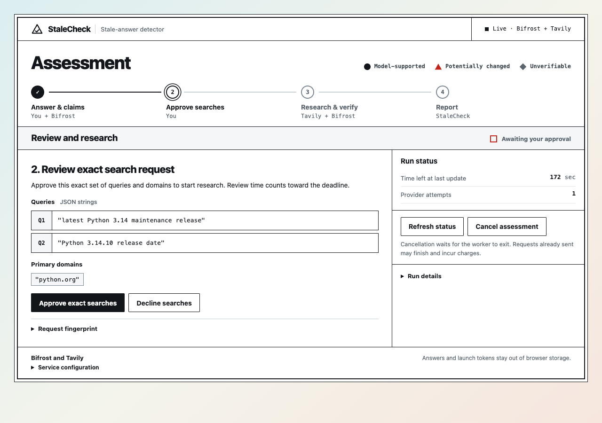
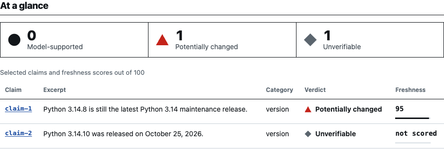
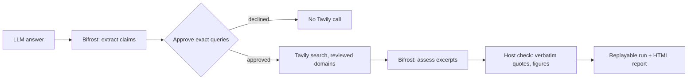

# StaleCheck: a stale-answer detector

[](../../actions/workflows/ci.yml)

**LLM answers go stale.** Prices, versions, support windows and policies change after a model is trained, and the answer still sounds confident. StaleCheck takes an LLM answer, extracts its time-sensitive claims through the **Maxim Bifrost** gateway, re-checks them against current sources with **Tavily** Search, and labels each claim *model-supported*, *potentially changed* or *unverifiable*, with a 0-100 freshness score, verbatim quotations and source links. Suggested edits are shown beside the original and never applied automatically.

Built for the **Geek Room Global AI Hackathon 2026**, Track B (Tavily), Problem Statement 06 *Stale-answer detector*. Tavily provides the live research; Bifrost carries every model request.

## See a real assessment

In a 27-second Chrome run, GitHub Copilot handled three model calls through Bifrost and Tavily ran two searches against `python.org`. StaleCheck flagged a superseded Python version and withheld a verdict on the release date because the retained quote lacked the date. The **95/100** score measures the recency of the first claim’s evidence.

| Searches approved in Chrome | Verdicts rendered from the saved live run |
|---|---|
|  |  |

[Review the live results and verify them offline](docs/LIVE-PROOF.md) · [Pitch deck](docs/pitch/StaleCheck-PS06.pptx) · [Submission checklist](docs/SUBMISSION.md)

[Run the live Copilot demo](docs/COPILOT-BIFROST-SETUP.md) · [Run the credential-free mock demo](docs/HACKATHON-DEMO.md#run-the-browser-demo)

## Features

- **Claim extraction through Bifrost**, kept only when each claim is an exact span of the answer.
- **Two consent steps:** upload consent for the full answer, then approval of the literal Tavily queries and domains. Declining sends no search.
- **Evidence guard:** a verdict changes only on a substantive quotation found verbatim in a retrieved source; supporting quotes must repeat the claim's figures.
- **Freshness score:** a 0-100 score per claim from the age of the newest quoted source, plus preferred-domain match and an uncalibrated evidence-strength heuristic, with links to every retrieved source.
- **Evidence separated from inference:** model observations, rationales and rewrites are labelled model-generated.
- **Bounded spending:** per-run attempt and time ceilings, a shared call ledger, no automatic retries, checkpoints kept on failure.
- **Replayable runs:** download the complete run as a ZIP and check the artifact hashes and report derivation with `verify-artifacts`. The HTML report shows why each verdict was reached.
- **Local assessment web app** (`serve-assessment`) for the whole journey in the browser; the packaged app needs no Node runtime.
- **Real Copilot + Tavily path:** `scripts/copilot-check/run.sh` routes model requests through GitHub Copilot via Bifrost, then performs approved live searches through Tavily. It uses no local model; setup and billing notes are in [the Copilot guide](docs/COPILOT-BIFROST-SETUP.md).

## How Bifrost and Tavily are used

**Maxim Bifrost** ([`gateway.py`](src/stalecheck/gateway.py)) is the single LLM gateway for both model steps: claim extraction and evidence assessment. Calls go to Bifrost's OpenAI-compatible `/v1/chat/completions` with an explicit `x-bf-vk` virtual key and optional requested fallbacks (`--fallback provider/model`); the client never reroutes on its own. Bifrost's reported routing, latency and token usage are recorded per call in the run.

**Tavily** ([`acquisition.py`](src/stalecheck/acquisition.py)) is the live research step. Each selected claim can make one approved `/search` call, so claims can reuse an approved query. Calls use `include_domains` restricted to reviewed domains (`include_domains_mode: restrict`), `include_published_date` for the freshness estimate and `include_usage` for credit accounting. Results outside the reviewed domains are never used.

**Tavily through Bifrost (optional).** With `--search-relay NAME`, each approved search goes to Bifrost's relay at `/relay/NAME/search` instead of to Tavily directly. The Tavily key then lives only in the gateway, one virtual key authorizes both model and search calls and can be configured with a shared budget, and Bifrost's Relay Logs record every search with its cost. Configuration, the gateway's observed behaviour and the real-gateway check are in [docs/BIFROST-GATEWAY.md](docs/BIFROST-GATEWAY.md).

| Challenge requirement | How it is met |
|---|---|
| Accept an LLM answer and find time-sensitive claims | `stale-check --answer FILE` or the web app: Bifrost extracts claims and labels each pricing, API, version, law, leadership, availability or other; each must be an exact span of the answer or it is rejected and recorded |
| Re-check selected claims with live research | Tavily Search per query, restricted to reviewed domains, only after the exact queries are approved |
| Freshness score and confidence indicator with source links | Per claim: a 0-100 freshness score (age of the newest quoted source against the assessment date, from provider-estimated publication dates; not scored when no quoted source has a date), an uncalibrated evidence-strength heuristic, verbatim quotations and links to all retrieved sources |
| Supported, changed or cannot be verified | `MODEL_SUPPORTED`, `POTENTIALLY_CHANGED`, `UNVERIFIABLE` in a script-free HTML report |
| Evidence versus inference | A quotation is evidence only if it occurs verbatim in a retained source excerpt; relations, observations, rationales and rewrites stay labelled model inference and are never applied automatically |



## Quick start

Python 3.12+ is required (Node 22+ only to rebuild the web UI). From a fresh clone:

```bash
python -m venv .venv
# Windows Git Bash: source .venv/Scripts/activate
# Linux/macOS:      source .venv/bin/activate
python -m pip install .
mkdir -p runs

# Offline demo: scripted Acme scenario, no keys, no network.
python -m stalecheck stale-check --demo-v4 --output runs/stale-demo
python -m stalecheck verify-artifacts runs/stale-demo
python -m stalecheck stale-report runs/stale-demo --output runs/stale-demo.html

# Browser journey in demo mode (open the private launch URL it prints).
python -m stalecheck serve-assessment --output runs/assessment-session
```

### Live run with your own Bifrost and Tavily

1. Run a Bifrost gateway ([setup guide](https://docs.getbifrost.ai/quickstart/gateway/setting-up)) with at least one provider, and create a virtual key.
2. Get a Tavily API key at [app.tavily.com](https://app.tavily.com/home).
3. Put both keys in environment variables (the command line names the variables, never the values), then run:

```bash
export BIFROST_VIRTUAL_KEY=...   # your Bifrost virtual key
export TAVILY_API_KEY=...        # your Tavily key
python -m stalecheck stale-check --answer answer.txt --live --confirm-outbound \
  --gateway-url http://127.0.0.1:8080 --model openai/gpt-4o-mini --gateway-token-env BIFROST_VIRTUAL_KEY \
  --tavily-key-env TAVILY_API_KEY --primary-domain docs.example.com --output runs/stale-live

# Same run with Tavily behind the gateway: Bifrost's `tavily` relay holds the Tavily key, the virtual key
# authorises the search and its budget pays for model and search together. No Tavily key reaches this process.
python -m stalecheck stale-check --answer answer.txt --live --confirm-outbound \
  --gateway-url http://127.0.0.1:8080 --model provider/model --gateway-token-env BIFROST_VIRTUAL_KEY \
  --search-relay tavily --primary-domain docs.example.com --output runs/stale-live-relay
```

`--gateway-url` must be loopback HTTP or a remote HTTPS origin. For the browser app, set `BIFROST_URL`, `BIFROST_MODEL`, `BIFROST_VIRTUAL_KEY` and `TAVILY_API_KEY` (or `BIFROST_SEARCH_RELAY=tavily` to send the searches through the gateway), then add `--live` to `serve-assessment`. The full answer goes to Bifrost only after upload consent; Tavily calls require the separate exact-query approval. Approval format, call ceilings and outputs are in [docs/V4-CONTRACT.md](docs/V4-CONTRACT.md); the browser API and security boundary are in [docs/ASSESSMENT-API.md](docs/ASSESSMENT-API.md).

### Live run with GitHub Copilot and Tavily

The live launcher uses the signed-in GitHub Copilot CLI behind Bifrost. Tavily searches after approval of the exact request. You need a Copilot seat, the Bifrost gateway and a Tavily API key. Follow [the credential, setup, and billing guide](docs/COPILOT-BIFROST-SETUP.md) before running:

```bash
bash scripts/copilot-check/run.sh
```

The older `scripts/live-check/` and its result documents are retained as a clearly dated historical Ollama evaluation, not the current setup.

## Technologies, AI use and scale

**Technologies.** Python 3.12 standard library only (no runtime dependencies), tested with pytest; React 19, TypeScript, Vite and Vitest for the assessment page; Docker only for the optional real-gateway checks; GitHub Actions for CI.

**How AI is used.** At run time StaleCheck reaches language models only through Bifrost, to extract claims, assess retrieved excerpts and propose edits. Their output is untrusted: a claim must be an exact span of the answer, a quotation counts as evidence only if it occurs verbatim in a retained Tavily excerpt, and relations, rationales and rewrites stay labelled model-generated and are never applied automatically.

**AI-assisted development.** This repository was written with AI coding agents (GitHub Copilot agent mode, OpenAI Codex and Anthropic Claude) working under the owner's direction. The tests and checks described here were run on the committed code; model accuracy was measured only on one small, AI-labelled set (see below).

**Scalability.** Every run is bounded by claim, attempt and time ceilings with a shared call ledger, so operators can cap the number of requests and runtime up front. The assessment server is deliberately single-user and loopback-only; a multi-user deployment would sit behind Bifrost virtual-key budgets and rate limits.

## Evidence and limits

**November 11, 2026 live checks.** Eight of ten verdicts aligned with primary sources and two abstained. The cases cover release versions, service allowances, an API retirement and a leadership change. The [live proof and replay guide](docs/LIVE-PROOF.md) includes the original artifacts and provider accounting.

Default commands need no credentials and make no network calls. The live path is covered by mock contract tests and has run end to end on a real stack (`scripts/live-check/run.sh`, 2026-11-02): a real Bifrost 2.4.0 container, a small open-weights model (Qwen2.5-3B-Instruct, 4-bit, served by Ollama on CPU) behind it, and the real Tavily API, once with direct searches and once with the searches relayed by Bifrost. Each journey took about 80 s (four model calls, 6.3 k tokens as reported by Bifrost, three Tavily credits), ended with two claims potentially changed and one unverifiable, and verified offline; the browser app completed the same journey in a real browser in both modes. A 28-check run against a Bifrost container with stand-in upstreams (`scripts/gateway-check/run.sh`: chat, fallback takeover, refusals, the Tavily relay, a virtual-key budget, Relay Logs) and a Tavily smoke test (`scripts/tavily-live-smoke.py`, one credit per query) complement it.

A first evaluation ([docs/LIVE-EVALUATION.md](docs/LIVE-EVALUATION.md), 2026-11-03) ran 26 one-claim answers about versions, support windows and Tavily's own pricing through a historical local-model stack; the labels were written by an AI agent and not reviewed by a human. 22 answers gave a usable claim, the 3B model proposed `CHANGED` for every claim it judged, and the host's quotation checks cut its 11 false alarms to 4 at the cost of 3 right verdicts (6 of the 22 judged answers right, interval 0.13-0.48). It is a method and a first signal, not an accuracy figure.

The historical evaluation did not use a hosted model, and demo token figures are scripted. The Copilot provider is configured as an opt-in live path; results still need to be evaluated on a human-reviewed dataset before making accuracy claims. Tests cover consent, bounds, tamper detection and fail-closed validation with scripted provider replies. A scripted guard ablation (`scripts/evaluate_guards.py`, 576 synthetic cases, mostly flawed model behaviours by construction, so not rates) takes false promotions from 240 to 48 and missed promotions from 48 to 240. The older `--demo` fixture (schema 3.0) remains replayable. Tavily's `published_date` is a beta estimate and may be null, so a claim without a dated quoted source is not scored.

## Repository layout

| Path | Contents |
|---|---|
| `src/stalecheck/` | The package: `gateway.py` (Bifrost client), `acquisition.py` (Tavily adapter), the stale-answer journey and verifier, the loopback assessment server, and the packaged UI in `assessment_static/` |
| `web/` | React and TypeScript source of the assessment UI; `npm run build` writes into `src/stalecheck/assessment_static/` |
| `tests/` | pytest suite: consent, bounds, tamper detection, gateway and relay contracts, the assessment server, guard fuzzing |
| `scripts/` | `copilot-check/` (current GitHub Copilot + Bifrost + Tavily setup), `live-check/` (historical local-model evaluation), `gateway-check/` (28 checks against a real gateway), the evaluation and guard-ablation scripts, browser checks |
| `docs/` | Stale-answer contract, assessment API, Bifrost gateway notes, live evaluation, the earlier v1/v2 lifecycle-verification docs, pitch deck and screenshots |
| `fixtures/` | Frozen fixtures for the v1/v2 replay paths |

## Development

```bash
python -m pip install -e ".[test]"
python -m pytest -q

cd web
npm ci
npm run typecheck && npm test
npm run build        # rewrites src/stalecheck/assessment_static; commit the result
```

## Documentation

- [docs/V4-CONTRACT.md](docs/V4-CONTRACT.md): the consent-gated stale-answer journey, bounds and accounting.
- [docs/ASSESSMENT-API.md](docs/ASSESSMENT-API.md): the local web app's API and trust boundary.
- [docs/BIFROST-GATEWAY.md](docs/BIFROST-GATEWAY.md): how the gateway and the Tavily relay are used and what was observed.
- [docs/LIVE-EVALUATION.md](docs/LIVE-EVALUATION.md): the first evaluation and its limits.
- [docs/README.md](docs/README.md): index of the earlier offline lifecycle-verification documents (v1/v2).

## Team and contact

Built by [@vishwateja8483](https://github.com/vishwateja8483).

Third-party notices are in [THIRD_PARTY_NOTICES.md](THIRD_PARTY_NOTICES.md); security reporting is described in [SECURITY.md](SECURITY.md). Licensed under the [MIT License](LICENSE).
