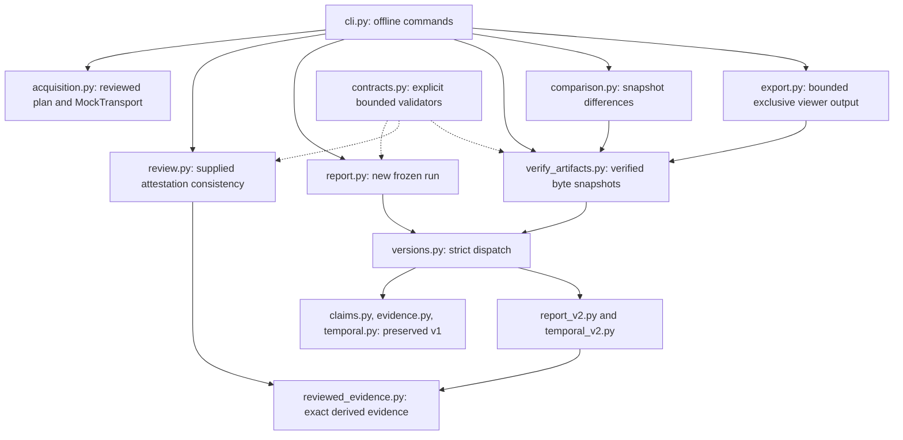
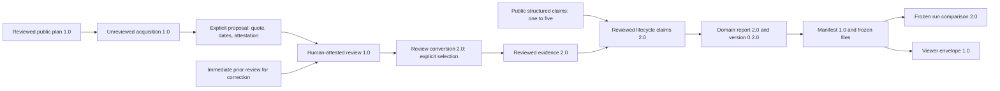
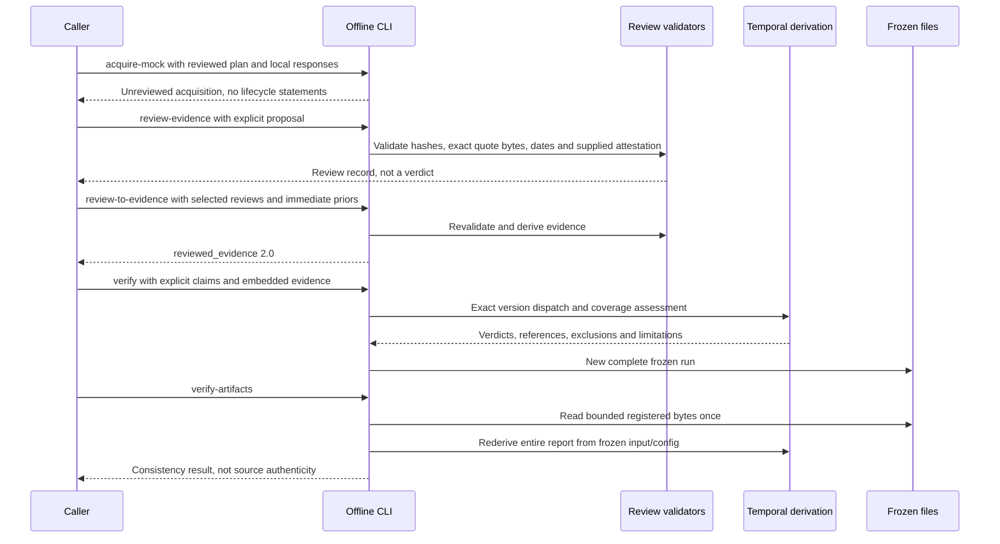
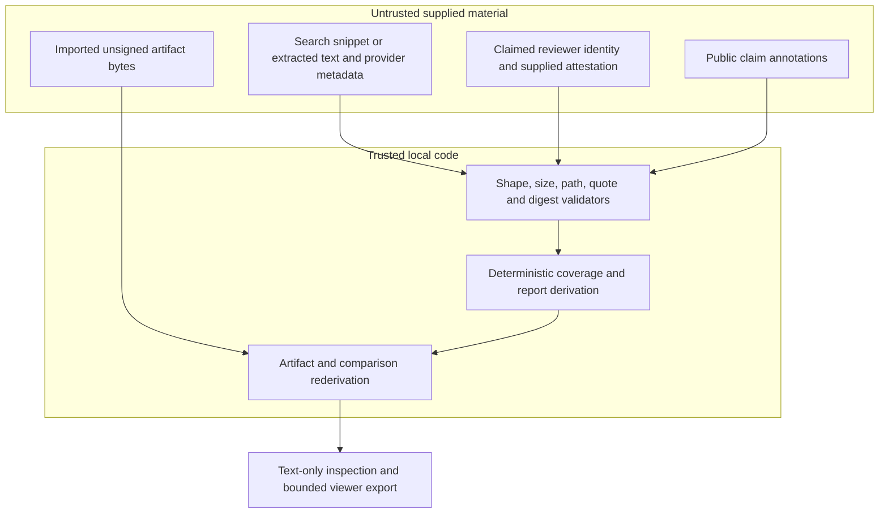

# StaleCheck architecture

## Scope and document paths

StaleCheck independently assesses explicit lifecycle claims against frozen evidence. The implemented offline v2 path converts **supplied** review attestations, derives temporal explanations, verifies complete run artifacts, compares two verified snapshots, and exports a bounded JSON bundle. This guide covers that offline lifecycle workflow (v1/v2); the stale-answer journey that uses Bifrost and Tavily (v3/v4) is specified in [V4-CONTRACT.md](V4-CONTRACT.md). It neither invents reviews nor authenticates their authors or source truth. Offline replay commands require no credentials; `stale-check --live` explicitly opts into credential-backed outbound gateway and search requests.

Paths here are relative to the repository root containing `README.md`, `pyproject.toml`, `src/`, `fixtures/`, and `docs/`. See `V2-CONTRACT.md`, `USER-GUIDE.md`, `DEVELOPMENT.md`, and `OPERATIONS.md` in this documentation set.

Current `cli.py`, `versions.py`, the v2 modules, contract, and `fixtures/v2-cli/` establish the implemented source path. Distribution metadata is `0.4.0`; v2 domain config/report version is `0.2.0`. Historical installed wheels must be checked separately.

## Modules

Acquisition is separate from assessment. A mock response or optional separately authorized Python acquisition call produces **unreviewed** candidates, not evidence statements or a verification run. Assessment, verification, comparison, and export never fetch source URLs.

## Data lineage and versions

- Review proposal hashes bind the acquisition, candidate metadata, and exact content. Quote offsets are UTF-8 byte offsets and must delimit the exact supplied quote.
- Review conversion has exact fields `schema_version`, `format`, `reviews`. Each entry has `review` and **always-present** `previous_review` (null for an original review). One to 100 distinct review digests are accepted; duplicates reject, not silently deduplicate.
- A derived source ID is `review-<review_sha256>` and its one statement ID is `statement-<review_sha256>`. The source retains content, URL, clocks, hashes, extraction method, and provenance `human_attested_acquisition`; the statement retains reviewed interval, end state, quote offsets, and review digest.
- Original acquisitions remain unchanged inside selected reviews. Conversion revalidates reviews; it does not fill missing dates, repair partial acquisitions, invent approvals, or fetch ancestors.
- A correction needs the immediate previous record. That record provides linkage, not automatic temporal supersession. Only selected reviews become evidence. Selecting both contradictory original/corrected statements can yield conflict.
- Strict v2 input contains exactly `schema_version`, `format`, `answer_text`, `answer_date`, `verification_date`, `scope`, `claims`, `reviewed_evidence`. Claims require id/text/subject/assertion/scope/public and optional `as_of`. Only `is_supported` and `public: true` are accepted.

| Layer | Version and behavior |
|---|---|
| Acquisitions and human review records | Existing `1.0` contracts |
| V1 request | `1.0`, answer or public lifecycle annotations; old derivation retained |
| V2 request/conversion/evidence/report | `2.0`; exact format dispatch, no fallback |
| V2 config | `package_version: "0.2.0"`, algorithm `reviewed-lifecycle-intervals-v2`, max_claims 5, network false, model null |
| V2 report | `schema_version: "2.0"`, `version: "0.2.0"`; includes retained reviewed evidence and explanations |
| Run manifest and event interchange | Remain `1.0` envelope conventions |
| Comparison | `2.0`, `frozen_run_comparison`; separate document |
| Viewer export | Exact envelope `1.0`; v2 remains inside report |

## Temporal assessment and explanations

Dates are day-level Gregorian points, not intra-day timestamps. Coverage is half-open `[effective_from,effective_to)`: a dated end excludes its own date. An explicit `open_ended` end requires no end date; `unknown` never establishes coverage. Missing start also never establishes coverage. V1 null end retains its old open-ended meaning and must not be reinterpreted as v2 unknown.

Claim target is explicit original `as_of`, otherwise `verification_date`. `answer_date` is optional/null and cannot be later than verification. Retrieval time, estimated publication/update time, review timestamp, and lifecycle applicability are distinct. No latest-source-wins rule exists.

Each claim's `explanation` retains original as-of, target, answer/verification dates, a top-level reason code, and `prior`/`current` assessments. Each assessment has `date`, `state`, `support`, `contradiction`, `excluded`. States are `unavailable`, `no_coverage`, `supported`, `contradicted`, or `conflict`; absent answer date makes prior unavailable. References bind evidence ID, statement ID, and review digest. Exclusion reasons are subject/assertion/scope mismatch, unknown start/end, not yet effective, or ended.

Eligibility checks precede verdict promotion. An ambiguous, wrong-scope, or future claim can have mechanically covering statements but must still abstain; read the top-level reason code rather than treating `current.state` alone as the verdict.

| Verdict | Required interpretation |
|---|---|
| `SUPPORTED_AS_OF` | Unconflicted positive reviewed coverage at target |
| `CONTRADICTED_AS_OF` | Unconflicted negative coverage without an established stale transition |
| `STALE` | Present-tense target, unconflicted support at answer date, unconflicted contradiction at target, and active false statement beginning strictly after answer date |
| `ABSTAIN` | Conflict, missing known coverage, ambiguous interpretation, future target, or request scope mismatch |

Historical statements remain historical: later lifecycle change does not turn a supported historical claim stale. Freshness labels are ordinal display categories, not confidence/probability or source truth measurements.

## End-to-end sequence

Run files are `manifest.json`, `input.json`, `config.json`, `report.json`, `events.jsonl`, and `errors.jsonl`. Input hashes bind canonical saved JSON, not the original user's whitespace. The writer validates first, writes an incomplete manifest, then payloads and final completion; interrupted writes are not resumable accepted runs. Verification only accepts completed replay runs and checks registered bytes, paths, exact domain derivation, sequences and terminal events. Comparison and export consume verified byte snapshots rather than unchecked subsequent rereads.

## Comparison and export boundary

Comparison verifies each run independently, binds exact manifest/input/config/report digests and run IDs, and matches full subject/assertion/scope/**original** as-of identity. Reusing a display ID does not establish a match. Duplicate semantic identities reject as ambiguous; absent identities appear as added/removed claims.

`causes` lists snapshot-level content, extraction, statement, policy, clock, and provenance differences. Multiple categories can apply; they are not per-claim causal proof. `time_only` is true only with changed clocks and every other input/config unchanged apart from display claim IDs. A catch-all provenance category prevents other retained input changes from disappearing. The comparison is separate from the exported envelope.

Exports accept 1–20 unique own runs, serialize the established envelope `{schema_version,generated_at,runs,annotations,limitations}`, and enforce 5 MiB before exclusively opening the destination. Each run includes only manifest/report/events. No truncation, added comparison field, or schema downgrade is implied.

## Trust boundaries

Public-review flags are not secret detectors. Exact quotations do not prove semantic entailment. Reviewer identity is not authenticated; a correction chain is not a complete signed history. Provider publication metadata may estimate publication **or update**; snippets/extracted text are not original publisher bytes. Acquisition can remain partial. Unsigned hashes detect inconsistency, not coordinated forgery or real-world truth. The optional live Python adapter has separate explicit network/token gates and remains live-unverified; this offline v2 workflow adds no live capability.
