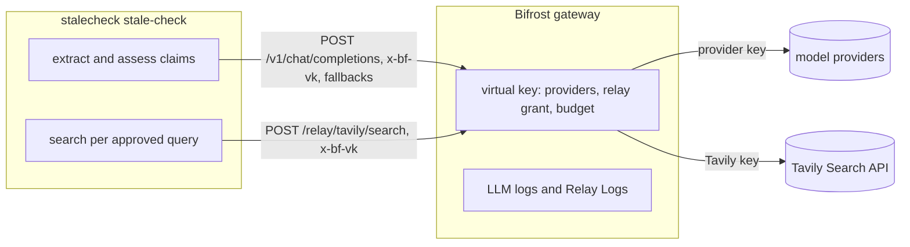

# StaleCheck on Bifrost: gateway, Tavily relay and budget

StaleCheck uses [Bifrost](https://docs.getbifrost.ai) twice. Every model call (claim extraction, assessment of the retrieved excerpts) goes through the gateway's OpenAI-compatible endpoint. Optionally, the Tavily search goes through the gateway too, as a Bifrost **relay**. That gives one place that holds the provider keys and the Tavily key, one virtual key that authorises a run, one budget that caps model and search spend together, and one set of logs.



| | Direct (default) | Through the relay (`--search-relay NAME`) |
|---|---|---|
| Model calls | Bifrost, virtual key from `--gateway-token-env` | the same |
| Search calls | `api.tavily.com` with `--tavily-key-env` (default `TAVILY_API_KEY`) | `<gateway>/relay/NAME/search`, authorised by the virtual key |
| Tavily key held by | this process, for the length of the run | the gateway only; the process never reads it |
| Spend cap | none from the app | the virtual key's budget covers models and search; a spent budget refuses both |
| Record of search spend | Tavily's own dashboard | Relay Logs in the gateway (cost, units, status per call) |

The outbound disclosure printed before a live run says which of the two paths is used. The approved queries still go through the same exact-query approval; the relay only changes where they are sent.

## Set it up

1. Write a gateway configuration with your providers, a `tavily` relay and a virtual key. Secrets stay in environment variables (`env.NAME`). The blocks below follow the configuration that `scripts/gateway-check` runs against the real gateway; its model providers there are local stand-ins, so the `openai`/`anthropic` provider blocks are the standard Bifrost form but were **not run with live model providers**; the `ollama` provider block in `scripts/live-check/config.json` did run (see [With a real language model](#with-a-real-language-model)). The `tavily` relay block, with `https://api.tavily.com` and an `env.` credential, did run against the real Tavily API (see below).

   ```json
   {
     "$schema": "https://www.getbifrost.ai/schema",
     "client": { "enforce_auth_on_inference": true },
     "providers": {
       "openai":    { "keys": [ { "name": "openai-main",      "value": "env.OPENAI_API_KEY",    "models": ["*"], "weight": 1.0 } ] },
       "anthropic": { "keys": [ { "name": "anthropic-backup", "value": "env.ANTHROPIC_API_KEY", "models": ["*"], "weight": 1.0 } ] }
     },
     "relays": [ {
       "name": "tavily",
       "base_url": "https://api.tavily.com",
       "auth": { "type": "bearer" },
       "credential": { "value": "env.TAVILY_API_KEY" },
       "usage": { "units_path": "usage.credits", "cost_per_unit": 0.008 },
       "routes": [ { "method": "POST", "path": "/search" } ]
     } ],
     "governance": {
       "budgets": [ { "id": "stalecheck-budget", "max_limit": 5.0, "reset_duration": "1d", "virtual_key_id": "vk-stalecheck" } ],
       "virtual_keys": [ {
         "id": "vk-stalecheck", "name": "stalecheck", "value": "env.STALECHECK_VIRTUAL_KEY", "is_active": true,
         "provider_configs": [
           { "provider": "openai",    "allowed_models": ["*"], "key_ids": ["*"], "weight": 1 },
           { "provider": "anthropic", "allowed_models": ["*"], "key_ids": ["*"], "weight": 1 } ],
         "relay_grants": [ { "relay_name": "tavily" } ]
       } ]
     }
   }
   ```

   The `usage` block bills each search at `usage.credits` x `cost_per_unit` dollars. `0.008` is an illustrative price per Tavily credit; use the price of your plan.

2. Start the gateway with the secrets in its environment (an admin account for the dashboard is your decision; StaleCheck never uses the admin API):

   ```bash
   # save the configuration above as bifrost-data/config.json; the container runs as an unprivileged user,
   # so the directory must be writable for it
   mkdir -p bifrost-data && chmod a+rwX bifrost-data
   export OPENAI_API_KEY=... ANTHROPIC_API_KEY=... TAVILY_API_KEY=... STALECHECK_VIRTUAL_KEY=sk-bf-$(openssl rand -hex 16)
   docker run -d --name bifrost -p 127.0.0.1:8080:8080 -v "$PWD/bifrost-data:/app/data" \
     -e OPENAI_API_KEY -e ANTHROPIC_API_KEY -e TAVILY_API_KEY -e STALECHECK_VIRTUAL_KEY maximhq/bifrost:v2.4.0
   ```

3. Run a check with only the virtual key in the environment:

   ```bash
   export BIFROST_VIRTUAL_KEY="$STALECHECK_VIRTUAL_KEY"
   python -m stalecheck stale-check --answer answer.txt --live --confirm-outbound \
     --gateway-url http://127.0.0.1:8080 --model openai/gpt-4o-mini --fallback anthropic/claude-sonnet-4-5 \
     --gateway-token-env BIFROST_VIRTUAL_KEY --search-relay tavily --primary-domain docs.example.com --output runs/stale-live
   ```

   `--search-relay` needs `--gateway-token-env` and ignores `--tavily-key-env`. A gateway on another host needs an HTTPS hostname; plain HTTP is accepted for loopback only.

The assessment web page supports the relay too: start `serve-assessment --live` with `BIFROST_SEARCH_RELAY=tavily` instead of `TAVILY_API_KEY`. The service then drops any Tavily key it was given and the page lists `BIFROST_SEARCH_RELAY` as present.

## What the real-gateway check proves

`scripts/gateway-check/run.sh` starts `maximhq/bifrost:v2.4.0` in Docker and puts local stand-ins behind it: two OpenAI-compatible model endpoints (one can be switched off) and a Tavily Search endpoint that accepts only the secret the gateway holds. It then drives StaleCheck through the gateway, using the real command-line journeys. See [scripts/gateway-check/README.md](../scripts/gateway-check/README.md) for how to run it.

| Area | Checks | Asserted against the real gateway |
|---|---|---|
| Chat | 7 | A reply is served by the primary provider with integer token usage; a primary outage is served by the requested fallback and reported as a takeover (`is_fallback`); the model endpoints receive the gateway-held provider key and never the virtual key; a missing, unknown or ungranted key is refused as `virtual_key_required`, `access_not_found` or `provider_blocked` |
| Relay | 8 | A search through `/relay/tavily/search` returns Tavily's own JSON including `usage.credits`; Tavily sees one call carrying only the gateway-held secret; a missing, unknown or ungranted key is refused as `virtual_key_required`, `access_not_found` or `relay_blocked`; an unconfigured route (`/extract`) is refused with 404; refused calls never reach Tavily |
| Command-line journeys | 8 | Without approval only the extraction call is made and no search is sent, and the exact queries are printed first; an approved journey ends with one changed and one supported claim, three gateway calls, two relayed searches, two credits, no fallback and known routing, writes a run that verifies offline, and stores no key; a key without the relay grant stops at the first search, which never reaches Tavily |
| Budget and accounting | 5 | The virtual key's budget stops the relay after the spend reaches the cap (six searches at $0.008 against $0.045, the seventh refused as `budget_exceeded`); the same key is then refused for model calls and the journey stops before any upstream call; Relay Logs count each successful search, one credit and $0.008 each; refused calls are logged as errors at no cost; the budget counter equals the relay spend |

Last run: 2026-11-02, image `maximhq/bifrost:v2.4.0` (digest `sha256:a1c90607dcfd13c1fb2f9476ceb3bb24407a50ade7fdf3e61a59fb42b09e5c57`), Docker 26.1.5 in WSL2 Debian 13, Python 3.13: **28 of 28 checks passed**. As a control, four deliberately wrong gateway configurations each made the check fail: no relay grant on the key, a wrong relay secret, half the price per credit, and no budget.

What the stand-in check does not show: that a real language model extracts and judges claims well (its model is rule-based), or that the example configuration above works with live model provider accounts. The Tavily side was checked against the real API, and a small real model was run behind the gateway, in the next two sections.

## Against the real Tavily API

On 2026-11-02, with the owner's Tavily key and authorization, the same gateway image ran with the `tavily` relay pointing at `https://api.tavily.com`. The key lived only in the container's environment (`env.GATEWAY_CHECK_TAVILY_KEY`), and the container was given the Docker host's CA bundle read-only because this network inspects TLS. The model providers were still stand-ins at that point; a real model followed (next section).

| What was sent | Result |
|---|---|
| Two reviewed public queries (Tavily's credit pricing on `docs.tavily.com` and `tavily.com`; the latest stable Python release on `python.org` and `docs.python.org`), directly with `StdlibTransport` | HTTP 200 each, five results each, all inside the reviewed domains, `usage.credits` 1, no request parameter rejected |
| The same two queries through `BifrostRelayTransport` and the gateway's relay | HTTP 200 each with the same URLs and dates as the direct calls, credits 1; Relay Logs: two successes of $0.008 (`units` 1, `billed_units` 1), `total_cost` 0.016; the virtual key's budget counter 0.016 |
| One direct call with a deliberately wrong key | `Tavily HTTP 401; provider usage unknown`, no credit used, no key in the message |

The key did not appear in the Relay Logs API output, the budget API output or the gateway's log. In total four searches and four credits. To repeat the direct check with your own key, run `python scripts/tavily-live-smoke.py` (one credit per query, the key read from `TAVILY_API_KEY` and never printed); add `--relay NAME --gateway-url URL --token-env NAME` to send the same queries through a relay.

What the live responses showed beyond the documentation:

- Every result carries `published_date` as an RFC 2822 string, which the adapter parses. For pages that are updated in place the date can be far older than the content: python.org's Windows downloads page was dated 2022-10-25 while its excerpt listed a release of 2026-10-21, and its source-releases page was dated 2006. StaleCheck's freshness score is the age of the quoted source's provider-estimated date and is labelled uncalibrated: read it as the age of that date, not as proof that the page is old or the claim stale.
- Relay Logs keep the request body and the response body (`request_body`, `response_body`), so a search and its retrieved excerpts are stored in the gateway. Bifrost has content-logging switches (`disable_content_logging`, global or per virtual key) for deployments that must not retain them; they were not exercised here.

## With a real language model

No hosted-model credentials were available, so the language model is a small open-weights one on the same machine: Qwen2.5-3B-Instruct (4-bit GGUF) served by Ollama on four CPU cores. Bifrost reaches it through its `ollama` provider (`scripts/live-check/config.json`), so every model call took the production route: StaleCheck, then the gateway with a virtual key, then the model. The script creates the gateway, its virtual key and its admin setup token itself; nothing has to be obtained from anyone.

`scripts/live-check/run.sh` ran on 2026-11-02 (Bifrost 2.4.0, Ollama 0.40.13, the real Tavily API, `python.org` as the reviewed domain, the answer in `scripts/live-check/answer.txt`). The same journey, run twice:

| | Tavily called directly | Tavily through the Bifrost relay |
|---|---|---|
| Duration | 77 s | 78 s |
| Calls | 4 model calls, 3 searches | 4 model calls, 3 searches |
| Tokens reported by Bifrost | 6,343 (complete) | 6,343 (complete) |
| Tavily credits | 3 | 3; Relay Logs: 3 successes, $0.024 |
| Model routing | `ollama/qwen2.5:3b`, no fallback | the same |
| Outcome | 2 claims potentially changed, 1 unverifiable | the same |
| Run artifacts | verify offline, no key in any file | the same |

The browser app ran the same journey in a real browser (Edge, headless) in relay mode with no Tavily key in the service: 86 s, 7 attempts, the same three verdicts, no page errors and nothing in browser storage (`scripts/check-assessment-live.mjs`).

What a real model showed about the pipeline:

- **Claim 1** ("Python 3.12 is the newest stable release of Python."): Tavily returned python.org pages, among them the 3.13 release notes and a 3.15 release candidate dated 2026-10-09. The model quoted two of them, both quotes were verbatim, so the claim is *potentially changed* with a freshness score of 93.
- **Claim 2** ("Python 3.8 reached end of life in October 2024"): the model answered CHANGED, but its quotes only support the claim. The host found no contradicting quote and reported *unverifiable* (`NO_VERBATIM_CONTRADICTING_QUOTE`) instead of passing the model's verdict on.
- **Claim 3** (the free-threaded build): *potentially changed* on verbatim quotes. The model's proposed rewrite ("... is not mentioned in the sources ...") is its own inference, labelled model-generated and never applied. Treat a 3B model's reasoning as unreliable; the report says so and asks for human review.
- **Reply contract.** `qwen2.5:1.5b` answered the extraction prompt with a bare JSON array in a code fence and a quotation that is not in the answer; StaleCheck recorded `invalid_reply`, selected no claim and searched nothing. In one run `qwen2.5:3b` added a full stop that the answer does not have at that place, and that quote was rejected as `quote_not_in_answer`. Over the 26 answers of [LIVE-EVALUATION.md](LIVE-EVALUATION.md) the 3B model also copied the category list from the prompt as a claim's category and cited a source by the prompt's hashed delimiter instead of its id; both are now read leniently (the category is shown as `other`, the delimiter resolves to its source) and the verbatim-quotation checks are unchanged.
- **A timeout.** In the first run of the day, while other programs loaded the host, Bifrost answered 504 after its 55 s provider timeout on the second assessment. StaleCheck recorded `gateway_failed`, did not retry, skipped the third claim and still wrote a report that verifies offline (one verified claim, two unverifiable). The same call took 24 s on an idle host. A model call is limited to 60 s by default and a journey to 180 s, so a CPU-only model needs about three claims or fewer; `--gateway-timeout` raises the per-call limit (up to 180 s) for a slow model, with a matching provider timeout in the gateway (`CALL_TIMEOUT` in `scripts/live-check/run.sh`). On the shared four cores an assessment call later took from about 15 s to over 130 s, and the evaluation ran with 150 s.
- **Gateway accounting.** Every reply carried the token usage and the serving provider and model; Relay Logs recorded each relayed search with its cost.
- The gateway logs "No admin account is configured ... the /api surface is locked until dashboard auth is enabled". That concerns the dashboard and the admin API only: model calls and the relay work with the virtual key alone.

The sample answer above is only a smoke test. [LIVE-EVALUATION.md](LIVE-EVALUATION.md) scores 26 labelled answers on the same stack: 22 gave a usable claim, the 3B model proposed `CHANGED` for every claim it judged, and the host's quotation checks cut its 11 false alarms to 4 at the cost of 3 right verdicts. The labels were written by an AI agent and not reviewed by a human, and the set is small. Whether a hosted model does better is untested; the setup is the same with another provider block.

## What the gateway returned

Observed with the check above (Bifrost 2.4.0). StaleCheck reports a refusal by status and, for model calls, by `type`, and never echoes gateway text.

| Situation | HTTP | `type` | StaleCheck |
|---|---|---|---|
| Chat served by the primary | 200 | | `served_by.is_fallback` false (the gateway omits the false value) |
| Primary down, fallback requested | 200 | | `served_by` names the backup, `is_fallback` true |
| No virtual key | 401 | `virtual_key_required` | model call fails: `gateway_failed` |
| Unknown or revoked key | 401 | `access_not_found` | same |
| Provider not granted to the key | 403 | `provider_blocked` | same |
| Relay not granted to the key | 403 | `relay_blocked` | search fails: `search_failed` |
| Route not configured on the relay | 404 | none | `search_failed` (StaleCheck only calls `/search`) |
| Budget spent | 402 | `budget_exceeded` | the next model call or search is refused; the journey stops |

Budget behaviour worth knowing: the gateway compares the key's running spend with the cap before each call, so the call that crosses the cap still completes and the next one is refused. One budget on the virtual key covers model calls and relay calls. Counters and logs are written in batches, so they show a spend a few seconds late.

A search refused by the relay appears in the run as `search_failed`; the run artifacts do not record whether the cause was the budget, the grant or Tavily itself. The gateway's Relay Logs do. The run's `provenance.search` stays `tavily` on both paths, since Tavily is the provider either way; the relay is not part of the run contract.

## Operating notes

- Bifrost 2.4.0 exits at start-up when it cannot download its model price list from `getbifrost.ai`, for example behind a TLS-inspecting proxy whose certificate authority the container does not trust. Give the container your CA bundle, or serve a copy of the price list yourself and set `framework.pricing.pricing_url`, as the check does. The relay's calls to Tavily need the same trust: the live run mounted the Docker host's `/etc/ssl/certs/ca-certificates.crt` read-only over the container's copy, which was enough to reach `api.tavily.com`.
- A fresh gateway has no dashboard password. Bind it to loopback (`-p 127.0.0.1:8080:8080`) or create an admin account before exposing it; see the Bifrost setup guide.
- The relay also accepted the virtual key as `Authorization: Bearer` and as `x-api-key` in an exploratory run that is not part of the check. StaleCheck sends `x-bf-vk` only.
- A relay pins every request under its `base_url`, injects its own credential and refuses routes that are not listed, so a virtual key with the relay grant can search but cannot reach any other Tavily endpoint.
