# StaleCheck development guide

## Standalone project layout

Paths below are relative to the repository root: `README.md`, `pyproject.toml`, `src/stalecheck/`, `tests/`, `scripts/`, `fixtures/`, and `docs/`.

Python 3.12+ and a standard-library runtime are declared. `pyproject.toml` defines the `stalecheck` console entry point, no runtime dependencies, and `pytest>=8,<10` in the test extra. Distribution metadata and the module version are `0.4.0`; v2 input/report schema is `2.0` and v2 config/report domain version is `0.2.0`. Package versions and frozen schema/provenance versions are distinct: do not rewrite retained artifacts when preparing a patch. Identify the source commit and wheel hash when recording installed acceptance.

## Development commands (not run by this documentation)

Use a dedicated environment with an explicit project path:

```sh
python -m venv /absolute/path/stalecheck-dev
/absolute/path/stalecheck-dev/bin/python -m pip install -e '/absolute/path/stalecheck[test]'
/absolute/path/stalecheck-dev/bin/python -m pytest -q -c /absolute/path/stalecheck/pyproject.toml /absolute/path/stalecheck/tests
```

Windows uses `Scripts/python.exe`. Installation can acquire missing build/test dependencies; obtain approved dependencies separately when offline or approval is required. No tests, installation, or build were run for these guides.

Source-only fixture generation, when intentionally requested by an operator:

```sh
python -I /absolute/path/stalecheck/scripts/generate_v2_fixture.py --output /absolute/path/work/new-v2-fixture
```

The existing driver locates only this product's `src`, invokes actual CLI subprocesses with `-I -O`, and writes invented attestation fixtures and a transcript. It is not runtime human review and must not be presented as an installed-wheel check. Choose an absent output directory; do not overwrite retained reference fixtures. Use the explicit isolated source CLI prefix in `USER-GUIDE.md` for individual source commands.

## Module responsibilities

| Source file under `src/stalecheck/` | Responsibility |
|---|---|
| `cli.py` | Offline command surface and JSON/exit handling |
| `contracts.py` | Bounded files, safe paths, duplicate-key/type/date/hash validation |
| `acquisition.py` | Reviewed public plan, bounded provider normalization, mock transport, separate explicit live Python adapter |
| `review.py` | Exact retained acquisition/proposal/quote validation and immediate prior linkage |
| `reviewed_evidence.py` | Explicit review selection, deterministic source/statement identities, retained acquisition provenance |
| `claims.py`, `evidence.py`, `temporal.py` | Preserved v1 narrow extraction, frozen annotations, temporal rules |
| `versions.py` | Exact allowlisted input/config dispatch; no validation fallback |
| `report.py` | Preserved v1 derivation and shared frozen-run writer |
| `report_v2.py`, `temporal_v2.py` | Strict v2 request/config, coverage, eligibility, explanations and reports |
| `verify_artifacts.py` | Safe byte snapshot, exact manifest/domain/event checks and rederivation |
| `comparison.py` | Semantic matching and verified snapshot-level difference attribution |
| `export.py` | Exclusive bounded JSON output and unchanged viewer envelope |

`fixtures/v2-cli/` is retained synthetic producer evidence. `scripts/generate_v2_fixture.py` is source tooling, not a new runtime CLI command. Project-level fixture/test directories are not guaranteed wheel resources: package data currently selects `src/stalecheck/fixtures/*.json`.

## Extension rules and review gates

```mermaid
flowchart LR
    Contract[Review schema and assurance boundary] --> Pure[Implement pure validation and derivation]
    Pure --> Writer[Wire explicit producer and version dispatch]
    Writer --> Verifier[Recompute from frozen bytes]
    Verifier --> Negatives[Boundary, conflict, tamper and isolation checks]
    Negatives --> Fixture[Actual source CLI fixture and transcript]
    Fixture --> Release[Separate installed wheel acceptance]
```



1. **Preserve old bytes and semantics.** Do not change v1 null-end meaning or claim extraction as a side effect of v2 work. Unknown/mixed schema/config values reject; there is no exception-based fallback to old versions.
2. **Keep approval explicit.** Acquired content remains unreviewed. A converter validates supplied attestations, never generates reviewer identity, attested=true, dates, rationale, claims, or completeness. Injected instructions in provider text are data.
3. **Preserve quote and metadata identity.** Hash canonical snapshots with the product helpers. Offsets are exact UTF-8 byte ranges, not characters. Candidate URL, retrieval/publication metadata and extraction method matter alongside content. A new acquisition timestamp requires new hashes.
4. **Respect interval uncertainty.** `dated`, `open_ended`, and `unknown` are distinct. Missing start or unknown end cannot cover a date. Publication/retrieval never creates an interval. Day-level exclusive boundaries, conflicts, historical targets and stale transitions must stay explicit.
5. **Keep correction semantics honest.** Only an immediate supplied prior is checked. Do not infer a complete history or silently delete/supersede earlier selected statements. A future signed/authenticated/superseding review system requires a separate contract and implementation.
6. **Treat explanations as exported domain data.** Keep exact reason codes, eligibility, support/contradiction/exclusion references, original as-of and target. Reverify every field and type; mechanical coverage cannot override top-level abstention.
7. **Compare verified snapshots.** Use the exact bytes accepted by `load_verified_run`, not an unchecked reread. Match full semantic identity, reject ambiguous duplicates, preserve added/removed claims, allow multiple difference categories, and apply the strict time-only check. Causes describe retained inputs, not factual causality.
8. **Preserve bounded interchange.** Viewer envelope remains `1.0` with only generated_at/runs/annotations/limitations plus schema version. Domain v2 stays in report. Comparisons remain separate. Serialize/check 5 MiB before exclusive output creation; no truncation or new archive mode.
9. **Keep product isolation.** No third-party imports, implicit network/credentials, or provider/model invocation in assessment/verification/export. Live acquisition changes need separate paid-call authorization and acceptance; mock responses establish neither live compatibility nor cost.
10. **Fail explicitly under optimization.** Runtime validation uses exceptions, not removable assertions. Maintain limits for files, structure, nesting, references, path ancestors, symlinks/reparse points, duplicate keys, nonfinite numbers, booleans versus integers, and exact versions.

## Testing map and evidence discipline

- `tests/test_stalecheck.py`: core frozen temporal claims/artifacts and negative cases.
- `tests/test_acquisition.py`: mock acquisition contract, bounds, sanitation and partial outcomes.
- `tests/test_review.py`, `tests/test_review_cli.py`: exact supplied review boundary, offsets and correction linkage.
- `tests/test_versions.py`: supported-version dispatch and retained behavior.
- `tests/test_v2.py`: v2 review conversion, explanations, artifact rederivation, comparison/export and source CLI behavior.

Focus regression cases on exclusive end dates, unknown starts/ends, conflicting intervals, missing answer date, explicit historical as-of, future/ambiguous/scope-ineligible claims, canonical digest changes, duplicate review/semantic identities, tampering after rehashing, wrong-product exports, and boundary-sized files. Platform symlink privileges may affect test availability; a skip is not successful filesystem containment acceptance.

Retained `fixtures/v2-cli/cli-transcript.json` records actual source CLI outputs for its recorded revision; this guide inspected those records and the driver without rerunning them. No test totals are asserted here. Do not equate a mocked provider response, invented attestation, source subprocess, retained golden, or complete run with live retrieval effectiveness, authenticated review, current wheel acceptance, or publisher truth.

## Installed release acceptance

With an approved newly packaged wheel in an independent environment, inspect CLI help and run offline demo/artifact verification using the environment interpreter with `-I -O -m stalecheck`. Exercise v2 with explicit companion fixture paths, not assumed wheel-installed project fixtures. Verify before/after runs, compare/reverify comparison, and export from an unrelated clean directory without `PYTHONPATH` or any other installed copy.

Record interpreter and wheel/source identity, exact commands, exit codes and retained outputs; run IDs/timestamps and resulting manifest hashes change across fresh runs even when domain verdicts match. Viewer rendering acceptance is separate from valid export production. No package refresh, source compatibility test, browser test, build, install, live call, or new capability claim is performed by this documentation update.
