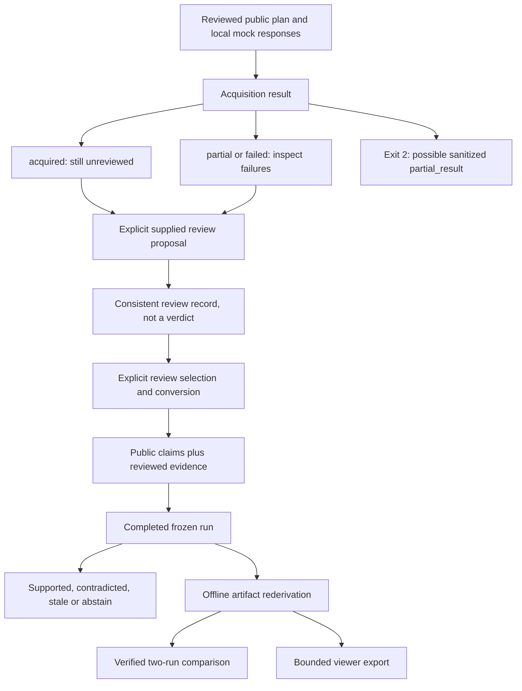

# StaleCheck operations

## Baseline and paths

StaleCheck's default demo, acquisition mocks, review, conversion, frozen assessment, artifact verification, comparison and export are offline and credential-free. Python 3.12+ is required; no runtime dependency is needed. Live assessment is a separate explicit opt-in through `stale-check --live --confirm-outbound` or `serve-assessment --live`, with answer-processing consent and exact-query approval. Live checks are recorded in [LIVE-EVALUATION.md](LIVE-EVALUATION.md) and [BIFROST-GATEWAY.md](BIFROST-GATEWAY.md); they do not guarantee connectivity or quality for a new installation. `doctor` does not contact providers or inspect credentials.

For the browser workflow, see [ASSESSMENT-API.md](ASSESSMENT-API.md). Launch with a new output directory and use `--port 0` if the default port is occupied. Port or missing-asset failures occur before output reservation; existing evidence is never removed to make a retry succeed. Demo answer/dates/domains are fixed, while budgets remain adjustable.

The pipeline below describes the legacy reviewed-evidence workflow, not the v4 model-assessment lifecycle.

Paths refer to the repository root. Source fixtures are under `fixtures/`; they are not automatically installed as wheel resources. See `USER-GUIDE.md` for installation and explicit source invocation.

## Pipeline end states



A complete acquisition remains unreviewed. A recorded review is not temporal verification. A completed assessment may abstain on every claim. A failed file write may leave an incomplete manifest which the artifact verifier rejects. These are different states and must not be collapsed into a generic success indicator.

All successful CLI commands return 0 and JSON on stdout. Validation/I/O errors return 2 with JSON on stderr; argument-parser errors also return 2, with usage text. `acquire-mock` can return 0 for `partial` or `failed` normalized acquisition, so inspect its JSON. Fatal acquisition errors may return bounded `partial_result` in stderr, preserving earlier candidates/attempts without claiming success.

## Safe operating procedure

1. Select the intended installed interpreter or explicit source revision. Metadata `0.4.0` describes the current packaging; the v2 domain config/report uses `0.2.0`.
2. Keep inputs, outputs, scripts, operator notes and exports separate. Receive each archive in a new directory; never execute received artifact scripts. Use safe ordinary nonlinked paths and static inputs.
3. Use new run directory/file names. Preserve exact reviewed content/metadata/quote bytes; do not prettify or edit frozen artifacts in place.
4. Check public-review attestations before supplying queries, URLs or claims. They do not detect secrets; all original input and embedded acquisition material can be retained in reports.
5. Inspect statuses and limitations at every stage, then verify whole runs before sharing. Store notes/export files outside completed run directories.
6. Keep both original runs and the comparison document together for re-verification; a viewer bundle alone omits required frozen bytes.

## Inspection and retention

| File / field | Inspect for |
|---|---|
| `manifest.json` | project `stalecheck`, mode `replay`, status completed, envelope `1.0`, registered lengths/hashes |
| `input.json` | Exact saved canonical input, explicit dates/claims, selected reviewed evidence |
| `config.json` | Exact supported policy/version; v2 network false, model null, max_claims 5 |
| `report.json` | Verdicts, limitations/warnings, quote/citation references, retained review/acquisition provenance, usage |
| `events.jsonl` | Consecutive sequence/run IDs, chronological start and completion |
| `errors.jsonl` | Empty for an accepted completed offline run |
| External acquisition/review/conversion files | Source lineage and deliberate selection; not themselves frozen run bundles |
| External comparison | Bound run IDs and exact manifest/input/config/report digests, causes and match rows |

V2 artifact verification revalidates supplied review records, reconstructs evidence and **every report/explanation field**, and checks type-exact report derivation. File hashes alone are insufficient. Files must match the registered set; adding a note or export inside a run intentionally invalidates that run. Keep originals immutable in trusted storage, copy complete directories for transfer, and reverify the copies. No signature/authenticated provenance is provided.

Installed command syntax:

```sh
python -I -O -m stalecheck verify-artifacts /absolute/path/before
python -I -O -m stalecheck verify-artifacts /absolute/path/after
python -I -m stalecheck compare --before /absolute/path/before --after /absolute/path/after --output /absolute/path/work/comparison.json
python -I -m stalecheck verify-comparison --before /absolute/path/before --after /absolute/path/after --input /absolute/path/work/comparison.json
python -I -m stalecheck export-viewer /absolute/path/before /absolute/path/after --output /absolute/path/work/viewer.json
```

Comparison/export independently invoke the product verifier, but explicit verification is useful for diagnosing the failed stage. The viewer supports only selected manifest/report/events from the unchanged envelope `1.0`; an appropriate viewer must understand report schema `2.0`. Comparison remains separate. Export 1–20 unique own runs, at most 5 MiB before file creation, with no truncation. StaleCheck's exporter does not provide a separate larger archive profile.

## Reading explanations and comparison

Start with claim verdict and `explanation.reason_code`, then original_as_of/target_date/answer_date/verification_date. `prior` refers to answer date; `current` refers to the target, which can be historical. A null answer date produces unavailable prior, not presumed historic support.

For each statement reference inspect support/contradiction/exclusion and its exact review digest. Exclusions include subject/assertion/scope mismatch, unknown start/end, not-yet-effective, and ended. A dated end is exclusive. `unknown` end never means open-ended; missing start cannot cover anything. Retrieval/publication dates and source ranking never resolve this uncertainty.

`STALE` needs a present-tense target, unconflicted earlier support, and later effective active contradiction. Without that transition, negative coverage is contradiction; conflicting coverage abstains. Mechanically covered evidence does not override top-level ambiguity, future-target or scope rejection. Freshness labels are ordinal, not probabilities.

Comparison matches full semantic identities rather than display IDs, rejects duplicate identities and explicitly labels added/removed claims. `causes` is a list of **snapshot-level** retained-input changes, not proof that a particular cause changed a particular claim. `time_only` requires everything except answer/verification clocks and display claim IDs to remain unchanged; a refreshed acquisition timestamp or reviewer rationale can defeat it even with identical content. Never report comparison as authenticated causal history.

## Bounds and failure recovery

- General file bound: 2,000,000 bytes; run registered payload total: 12,000,000 bytes. Artifact lists are bounded to 100 and filesystem traversal to 300 entries.
- V2 request: one to five explicit claims and one to 100 selected reviews; structural/repeated acquisition size bounds may reject sooner. Review validation additionally bounds depth/nodes and exact proposal fields.
- Viewer export: 5,242,880 bytes, 1–20 runs; duplicate run identities reject. Comparison and review/conversion JSON outputs use the general file bound.
- Acquisition plans are bounded to three queries, five explicit URLs and ten primary domains. Search hits are not automatically extracted. Provider output remains bounded, untrusted data, not instructions.
- Default live transport has retry/time/byte limits but OS DNS resolution can exceed a socket timeout. No hard process deadline or live effectiveness claim follows from mock behavior.

| Symptom | Inspect and recover safely |
|---|---|
| Missing v2 command | Check selected interpreter and wheel/source revision. Do not silently use stale installed code. |
| Review acquisition/candidate hash mismatch | A fresh capture changes metadata/hashes. Use the matching retained acquisition, or explicitly prepare a new review for the new snapshot. |
| Quote offset mismatch | Count exact UTF-8 bytes, not Unicode character positions; retain the original text and correct the proposal before creating a new review. |
| Invalid end-state fields | `dated` alone has effective_to and requires a later end; open/unknown omit it. Do not turn unknown into open to gain coverage. |
| Correction rejected | Supply matching immediate previous review and digest on both creation and verification. No automatic ancestor lookup exists. |
| Conflict after correction | Check which records were selected. Corrections do not automatically supersede prior facts. Deliberately select evidence; do not rewrite old reviews. |
| ABSTAIN despite matching content | Inspect unknown dates, exclusive ends, exact subject/scope, eligibility and conflict. Text membership is not coverage or entailment. |
| Invalid artifact/report after rehashing | Restore the complete original frozen set from trusted storage. Rehashing does not repair inconsistent domain derivation. |
| Comparison has added/removed rows or duplicate identity error | Inspect subject/assertion/scope/original as-of; display IDs are not semantic identity. Resolve the intended input before a new run. |
| More than clock cause / time_only false | Inspect input/config, acquisition metadata and review provenance, not only report verdicts. |
| Unregistered file or unsafe linked path | Keep copies on safe static ordinary paths; remove only known operator-added files from an owned copy or restore pristine artifacts. Never disable checks. |
| Existing output / oversize output | Choose a new filename or fewer exported runs. Do not truncate evidence. Serialization/size rejection occurs before export file creation. |
| Incomplete manifest after interrupted write | Preserve for diagnostics; verifier rejects it. No resume or in-place completion repair exists; retry to a new directory. |

General filesystem write failure can still leave partial output despite exclusive creation; do not claim transactional storage. Concurrent directory mutation is unsupported. Render provider text and quotes as escaped text, never HTML or executable instructions.

## Assurance and evidence status

The source v2 fixture driver and `fixtures/v2-cli/cli-transcript.json` demonstrate the recorded offline producer path with invented attestations. This documentation inspected source and those retained records; it ran no new tests, builds, install, CLI workflow, browser validation, or live calls. Fresh installed-wheel acceptance is separate. Mock usage is not paid usage; unavailable provider usage remains null rather than an invented cost.

Unsigned consistency cannot establish authenticated reviewer identity, semantic entailment, complete review history, publisher truth, what was known at an earlier date, or coordinated-forgery resistance. Partial acquisition stays partial even after reviewing selected candidates. Preserve these limitations when exporting, presenting, or troubleshooting results.
